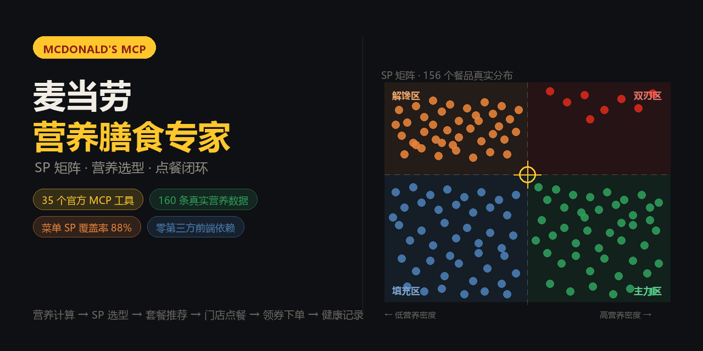
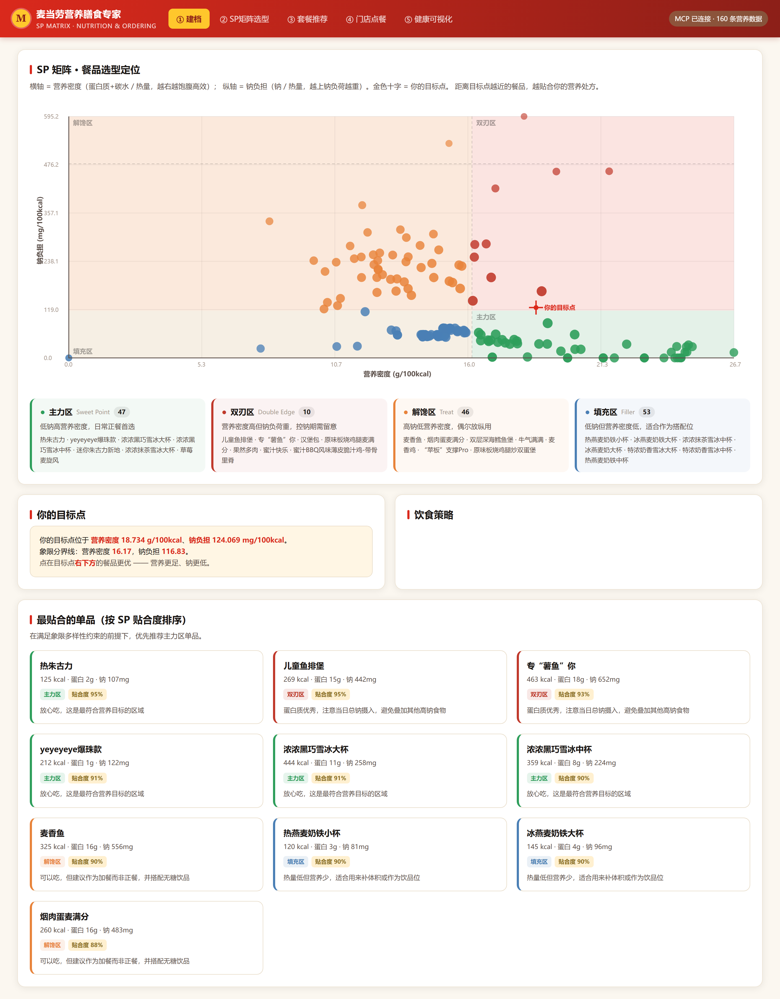
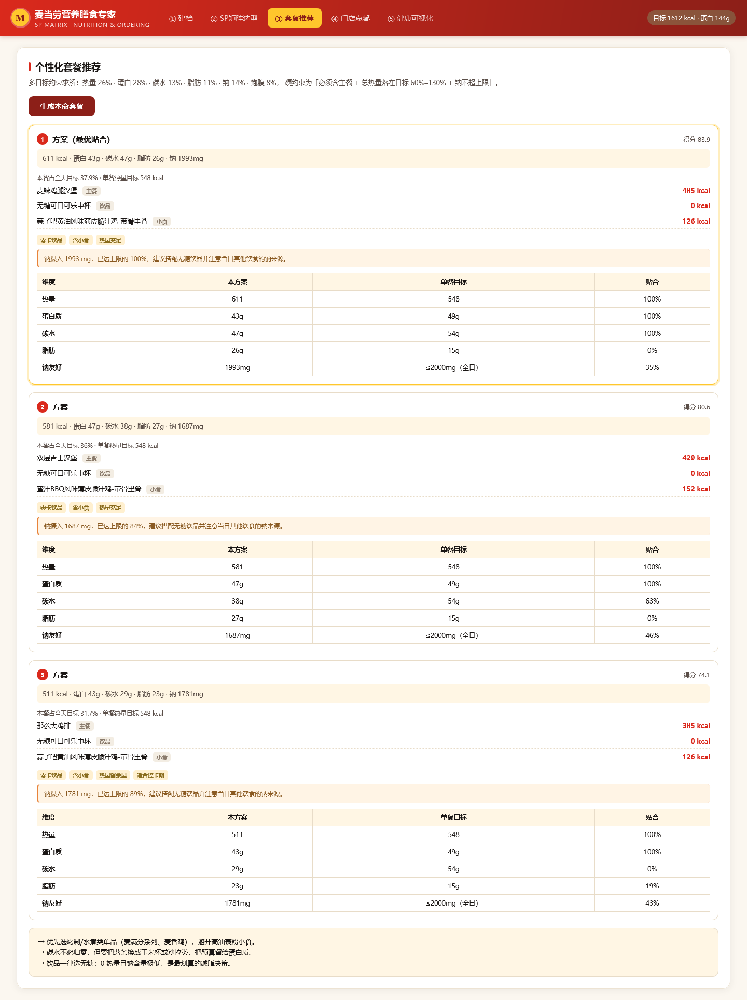
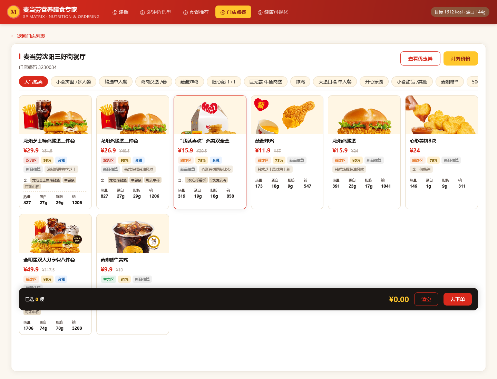
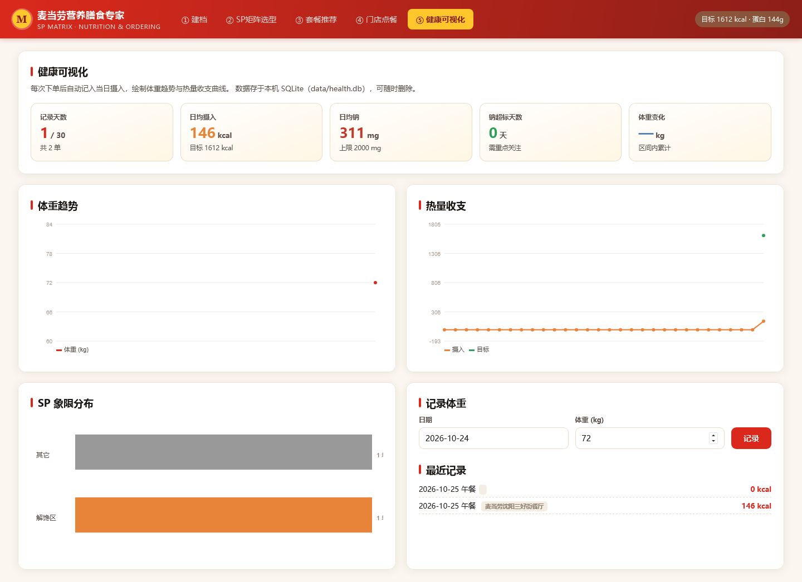

# 麦当劳营养膳食专家（McDonald's Nutrition Diet Expert）

> 身材管控期也想吃麦当劳？这个专家会帮你根据每日消耗搭配麦麦套餐。

一个基于 **SP 矩阵理论** 的个人饮食搭配可视化选型工具，基于麦当劳官方 MCP Server 打通「营养计算 → SP 选型 → 套餐推荐 → 门店点餐 → 领券下单 → 健康记录」的完整闭环。

[](https://github.com/M-China/mcd-mcp-server)
[](https://www.python.org/)
[](https://fastapi.tiangolo.com/)
[](LICENSE)
[](workbuddy.md)
[](https://github.com/ChinaOpenClaw/mcd-nutrition-expert/stargazers)

<p align="center">
  
</p>

<p align="center">
  
</p>

<p align="center"><b>SP 矩阵选型界面</b> —— 156 个餐品的真实分布，金色十字是按你的身体档案推导出的目标点</p>

<div align="center">

| 指标 | 数值 | | 指标 | 数值 |
|---|---:|:---:|---|---:|
| 官方 MCP 工具 | **35** | | 营养数据条目 | **160** |
| 门店菜单条目 | **98** | | 菜单 SP 覆盖率 | **88%** |
| 四象限分布 | 主力 47 / 解馋 46 / 填充 53 / 双刃 10 | | 动态阈值 | `P50×0.6 + P75×0.4` |
| REST 接口 | **14** | | 前端第三方依赖 | **0** |

</div>

---

## 〇、目标用户与使用示例

### 目标用户

| 人群 | 典型场景 | 本项目帮他解决什么 |
|---|---|---|
| **体重管理期人群**（减脂 / 塑形） | 加班到八点，只能吃麦当劳，不知道怎么点不超热量 | 按档案算出单餐 626 kcal 目标，直接给出结构合理的套餐（如 555 kcal 低钠方案） |
| **健身增肌人群** | 练完腿想吃麦当劳，需要高蛋白但不想钠爆表 | SP 矩阵的「双刃区」精确标注高蛋白高钠餐品，配合钠上限控制摄入量 |
| **有代谢指标关注需求的人** | 需要控钠（高血压、肾脏指标等日常管理） | 钠负担作为独立维度参与打分，高钠组合会被显著降权 |
| **不想做功课的普通用户** | 站在点餐机前 30 秒做不了决定 | 「一键求解」直接给出 3 套可执行方案 + 象限角标标注，决策时间 < 10 秒 |
| **餐饮 / 营养方向的开发者** | 想学如何把 MCP 用在真实业务场景 | 完整源码 + 架构文档 + API 文档 + 5 个真实接口陷阱记录，可直接复用于其他 MCP 集成 |
| **WorkBuddy 用户** | 希望在对话中直接完成选餐 | 以 Skill 形态交付，可在 WorkBuddy 会话内自然语言调用全链路能力 |

### 使用示例

> 以下所有数值均为**真实接口实测输出**（`POST /api/recommend`），非示意。

**示例 1 · 减脂期午餐（女 28 岁 / 165cm / 58kg / 中等活动 / 减脂）**

```
目标：全天 1625 kcal · 蛋白 116g · 碳水 189g · 脂肪 45g · 钠上限 2000 mg
    单餐目标 552 kcal（1625 × 34%）

方案一（评分 0.8214）
  637 kcal · 蛋白 44g · 钠 1878 mg · 占全天 39.2%
  · 主餐 麦辣鸡腿汉堡                     485 kcal
  · 饮品 无糖可口可乐中杯                   0 kcal
  · 小食 蜜汁BBQ风味薄皮脆汁鸡-带骨里脊   152 kcal
  ⚠ 钠 1878 mg，已达上限 94%
  ⚠ 热量比单餐目标高 84 kcal，训练日可接受，休息日建议减一份小食

方案二（评分 0.8162）—— 本餐钠负担最低
  580 kcal · 蛋白 33g · 钠 1049 mg · 占全天 35.7%
  · 主餐 双层吉士汉堡                      429 kcal
  · 饮品 优品豆浆小杯                       151 kcal

方案三（评分 0.7963）
  642 kcal · 蛋白 39g · 钠 1474 mg · 占全天 39.5%
  · 主餐 双层吉士汉堡                      429 kcal
  · 饮品 无糖可口可乐中杯                   0 kcal
  · 小食 麦乐鸡5块                        213 kcal
```

> 💡 系统的价值不止于「给出一套餐」，更在于**同时告诉你取舍在哪**：方案一蛋白最足但钠到 94%，方案二钠只有一半但蛋白少 11g —— 用户可以自己权衡，而不是在「不知道热量」和「只知道热量」之间二选一。

**示例 2 · 增肌日午餐（男 25 岁 / 178cm / 82kg / 高强度活动 / 增肌）**

```
目标：全天 3502 kcal · 蛋白 148g · 碳水 535g · 脂肪 86g · 钠上限 2000 mg
    单餐目标 1191 kcal

方案一（评分 0.7392）—— 含甜点
  1341 kcal · 蛋白 55g · 钠 1838 mg · 占全天 38.3%
  · 主餐 芝士安格斯厚牛堡                 696 kcal
  · 小食 麦麦脆汁鸡-琵琶腿                328 kcal
  · 饮品 可乐大杯                        224 kcal
  · 甜点 圆筒冰淇淋                        93 kcal
  ⚠ 钠 1838 mg，已达上限 92%

方案二（评分 0.7193）—— 推荐
  1028 kcal · 蛋白 54g · 钠 1744 mg · 占全天 29.4%
  · 主餐 芝士安格斯厚牛堡                 696 kcal
  · 小食 麦麦脆汁鸡-带骨里脊              332 kcal
  · 饮品 无糖可口可乐中杯                   0 kcal

方案三（评分 0.7144）—— 系统主动标红
  1130 kcal · 蛋白 47g · 钠 2149 mg
  ⚠ 钠摄入 2149 mg，已超出 2000 mg 上限（超出 149 mg）。
     这是本方案最需要你知晓的取舍点：建议把含糖饮料换成无糖、
     并避免同一天再叠加其他高钠食物。
```

> 💡 注意方案三：**系统没有藏起这个超标项**。它在 `warnings` 里主动把超出量算给你看，而不是给一个看起来很美的组合 —— 这正是「可解释」的含义。

**示例 3 · 领券点餐闭环（Web 界面）**

```
1. 建档 →  身高体重年龄 → 自动出全天目标与 SP 目标点
2. SP 矩阵 → 156 个餐品按四象限散点分布，金色十字 = 我的目标点
3. 套餐推荐 → 三套方案，含每样餐品的贴合度百分比
4. 门店点餐 → 点击门店 → 进店菜单，每个条目带象限角标 + 贴合度
             → 套餐自动展开内含单品
5. 领券 →  「我的卡包」显示已持有的券（显示券码）+ 可领取券
6. 下单 →  购物车实时计价 → 提交订单
7. 健康记录 → 吃完记一笔 → 体重趋势 + 热量缺口 + 象限分布回看
```

**示例 4 · 独立 Web 应用运行**

```bash
git clone https://github.com/ChinaOpenClaw/mcd-nutrition-expert.git
cd mcd-nutrition-expert/skills/mcd-nutrition-expert
cp .env.example .env          # 填入你的 MCP Token
pip install -r requirements.txt
python scripts/server.py       # → http://127.0.0.1:8899
```

**示例 5 · 作为 WorkBuddy Skill 调用**

见 `workbuddy.md`。核心触发语：

```
「帮我按 SP 矩阵推荐一套麦当劳套餐」
「我今天想吃麦当劳，算一下该怎么点」
「看看我的热量缺口够不够吃这一套」
```

---

## 一、核心洞察：为什么需要它

控卡期吃麦当劳，真正的痛点不是「不知道吃什么」，而是：

| 痛点 | 具体表现 | 本项目的解法 |
|---|---|---|
| **不知道该吃多少** | 全天目标 1800 kcal，不知道单餐该占多少 | Mifflin-St Jeor + FAO/WHO 活动系数算出全天 TDEE，再按单餐份额（34%）折算单餐目标 |
| **不知道该点哪个** | 菜单近百个条目，看得见的热量标签为零 | 160 个餐品全量营养数据 + SP 矩阵四象限定位 |
| **不知道哪套搭得值** | 套餐名看不懂，勾起来才发现全是糖和油 | 结构角色模型（主餐/小食/饮品/甜点）+ 多目标约束求解 |
| **不知道自己吃过了什么** | 吃完就忘，热量缺口无从谈起 | SQLite 每日记录 + 体重趋势 + 象限分布可视化 |

---

## 二、SP 矩阵理论的应用

### 2.1 从战略定位到饮食定位

经典 SP（Sweet Point）矩阵用「竞争强度」与「市场地位」划分战略象限。迁移到饮食选型，映射为两个营养密度维度：

| SP 原始维度 | 饮食映射 | 计算方式 | 业务含义 |
|---|---|---|---|
| X 轴（吸引力） | **营养密度** | (蛋白质g + 碳水g) / (热量/100) | 每 100 kcal 能带来多少克营养 |
| Y 轴（强度） | **钠负担** | 钠mg / (热量/100) | 每 100 kcal 带来多少钠负担 |

### 2.2 四象限

```
                    钠负担高
                       │
         ┌─────────────┼─────────────┐
         │             │             │
         │   解馋区     │   双刃区     │
         │  (低密度高钠) │ (高密度高钠) │
营养密度低┼─────────────┼────────── 营养密度高
         │             │             │
         │   填充区     │  主力区 ★   │
         │ (低密度低钠) │ (高密度低钠) │
         └─────────────┼─────────────┘
                       │
                    钠负担低
```

| 象限 | 定位 | 特征 | 建议 | 实测数量 |
|---|---|---|---|---:|
| **主力区** ⭐ | 日常主力 | 营养密度高、钠负担低 | 控卡期首选，建议常点 | 47 |
| **双刃区** | 双刃剑 | 营养密度高但钠也高 | 增肌日可吃，控卡日限一次 | 10 |
| **解馋区** | 情绪价值 | 营养密度低、钠负担高 | 想吃就吃，别当正餐 | 46 |
| **填充区** | 饱腹陷阱 | 营养密度低、钠负担低 | 减脂期尽量避开 | 53 |

> 上图方位与 `docs/screenshots/03-sp-matrix.png` 实际界面一致（X 轴向右为营养密度递增，Y 轴向上为钠负担递增）。
> 实测 156 个有效样本的分布：**主力区 47 / 解馋区 46 / 填充区 53 / 双刃区 10**。

### 2.3 贴合度 fit

每个餐品相对「你的目标点」计算归一化欧氏距离，映射到 0–100% 的贴合度：

```
fit = 1 - dist / 1.4
```

目标点由用户档案推导（蛋白+碳水密度、钠密度），因此**同一个餐品对不同人的贴合度完全不同**——这正是 SP 矩阵作为「个人化选型工具」的价值。

### 2.4 界面实录

| ② SP 矩阵选型 | ③ 个性化套餐推荐 |
|---|---|
|  |  |

散点图每个点是一个餐品，金色十字是你的目标点；右侧按贴合度排序，直接给出「最该点的那一个」。

| ④ 门店点餐 | ⑤ 健康可视化 |
|---|---|
|  |  |

菜单里每个条目都带 SP 象限角标与贴合度百分比；健康页把每日摄入与目标画在同一张图上，缺口一目了然。

---

## 三、功能全景

### ① 建档 · 营养目标计算

- **BMR**：Mifflin-St Jeor 公式；若用户填写体脂率则切换到 Katch-McArdle（瘦体重法）修正
- **TDEE**：BMR × FAO/WHO 活动系数（sedentary 1.2 / light 1.375 / moderate 1.55 / active 1.725 / athlete 1.9）
- **四种目标模式**：

| 模式 | 热量系数 | 蛋白质 | 说明 |
|---|---|---|---|
| 减脂 cut | TDEE × 0.80 | 2.0 g/kg | 20% 热量缺口，保肌 |
| 维持 maintain | TDEE × 1.00 | 1.4 g/kg | 体重管理 |
| 增肌 bulk | TDEE × 1.12 | 1.8 g/kg | 12% 盈余 |
| 塑形 recomp | TDEE × 0.90 | 1.8 g/kg | 温和缺口 + 高蛋白 |

### ② SP 矩阵可视化选型

- 原生 Canvas 绘制散点矩阵（零第三方依赖，离线可用）
- 象限底色 + 动态分界线（P50×0.6 + P75×0.4）
- 散点半径随贴合度变化，金色十字为你的目标点
- 四象限直方图统计

### ③ 套餐推荐求解器

**结构角色模型**（取代朴素分类笛卡尔积）：

```
主餐（唯一） → 小食（≤1） → 饮品（唯一） → 甜点（≤1）
```

硬约束组合：
- 主餐占本餐热量 40%–85%
- 角色级热量上限（比例 ∪ 真实规格绝对上限的较大值）
- 配菜必须带蛋白（≥6g）或足量主食（≥120 kcal）——防止「玉米杯」挤掉真正的蛋白源
- 减脂/塑形模式禁止甜点
- 钠 ≤ 全日上限 × 1.25

**多目标加权打分**：

| 维度 | 权重 | 说明 |
|---|---|---|
| 热量命中 | 26% | 相对单餐目标的偏离度 |
| 蛋白质 | 28% | 相对单餐蛋白目标 |
| 碳水 | 13% | |
| 脂肪 | 11% | |
| 钠友好 | 14% | 分段函数，超限强扣分 |
| 饱腹性价比 | 8% | 饱腹价值 / 热量密度 |

**局部搜索改进**：加一份 / 减一份 / 换一份三邻域迭代 + 多样性去重。

实测输出（25 岁男性 / 175cm / 70kg / 轻度活动 / 减脂，全天目标 1841 kcal、单餐目标 626 kcal）：

```
方案 1  719 kcal（占全天 39%）· 蛋白 44g · 钠 1981mg
   板烧鸡腿堡 + 麦麦脆汁鸡-琵琶腿 + 无糖可口可乐中杯
方案 2  611 kcal（占全天 33%）· 蛋白 43g · 钠 1993mg
   麦辣鸡腿汉堡 + 无糖可口可乐中杯 + 蒜了吧黄油风味薄皮脆汁鸡-带骨里脊
方案 3  555 kcal（占全天 30%）· 蛋白 46g · 钠 1802mg
   双层吉士汉堡 + 蒜了吧黄油风味薄皮脆汁鸡-带骨里脊 + 无糖可口可乐中杯
```

三套方案都满足「主餐唯一 + 饮品唯一 + 小食 ≤1 + 甜点 ≤1」的结构约束，
且饮品位固定落在零卡选项上——这是控卡期的关键：热量与钠的波动全部来自主餐与小食的选择。

### ④ 门店点餐（点击门店进入店内）

- 门店列表 → 点击进店 → 分类 tab → 菜单网格
- **每个菜单条目都带 SP 象限标签 + 贴合度 + 营养四宫格（热量/蛋白/脂肪/钠）**
- 套餐条目自动展开内含单品（「含：龙焰鸡腿堡 / 中薯条 / 可乐中杯」）
- 新品未收录营养表时按品类关键词近似估算，并显式标注「新品估算」
- 购物车 sticky bar → 实时计价（分/元双口径换算）→ 下单 → 自动记入健康档案

### ⑤ 优惠券与下单

- 可领取 / 我的卡包 / 本店可用三段式
- 一键领券（`auto-bind-coupons`）
- 计价与下单走 `calculate-price` / `create-order`，正确处理 `productCode` + `quantity` 契约与「分」单位

### ⑥ 健康可视化记录

- SQLite 三表分离：`daily_log`（日汇总）/ `meal_log`（明细）/ `profile`（档案）
- KPI 卡 + 体重折线 + 热量收支双线 + 象限分布条形图
- 自动补齐空日期，连续性趋势不断裂

---

## 四、技术架构

```
┌─────────────────────────────────────────────┐
│  web/index.html  （单文件前端 · 原生 Canvas）  │
│  ①建档 ②SP矩阵 ③套餐推荐 ④门店点餐 ⑤健康可视化 │
└──────────────────┬──────────────────────────┘
                   │ HTTP / JSON
┌──────────────────▼──────────────────────────┐
│  scripts/server.py   FastAPI + uvicorn        │
│  /api/health /api/target /api/matrix          │
│  /api/recommend /api/stores /api/menu        │
│  /api/coupons /api/cart /api/order            │
│  /api/records /api/records/weight /api/account│
└──────────────────┬──────────────────────────┘
                   │
   ┌───────────────┼────────────────┐
   │               │                │
┌──▼──────────┐ ┌──▼─────────┐ ┌────▼──────────┐
│nutrition_   │ │combo_      │ │sp_matrix.py   │
│engine.py    │ │solver.py   │ │  SP 四象限     │
│ BMR/TDEE    │ │ 约束求解   │ │  贴合度       │
│ 目标计算    │ │ 局部搜索   │ └───────────────┘
└─────────────┘ └────┬───────┘
                     │
┌──────────────┐ ┌───▼─────────┐ ┌──────────────┐
│mcp_client.py │ │health_store │ │              │
│ MCP 客户端   │ │  SQLite     │ │              │
└──────┬───────┘ └───┬─────────┘ └──────────────┘
       │             │
┌──────▼─────────────▼──────────┐
│  麦当劳官方 MCP Server           │
│  https://mcp.mcd.cn （35 个工具） │
└──────────────────────────────────┘
```

### 模块职责

| 文件 | 职责 |
|---|---|
| `scripts/nutrition_engine.py` | BMR/TDEE/目标计算、餐品分类表、策略建议 |
| `scripts/combo_solver.py` | 结构角色模型、多目标约束求解、局部搜索 |
| `scripts/sp_matrix.py` | SP 四象限计算、贴合度、象限多样性推荐 |
| `scripts/mcp_client.py` | MCP Streamable HTTP 客户端（限流/重试/退避） |
| `scripts/health_store.py` | SQLite 健康档案（三表分离） |
| `scripts/server.py` | FastAPI 后端 + 价格口径归一 + 套餐聚合 |
| `scripts/shoot_views.js` | Playwright 前端五视图截图验证（回归用） |
| `web/index.html` | 单文件前端（原生 Canvas 图表，零第三方依赖） |

### 菜单 SP 覆盖率

门店菜单里约 **56%** 的条目是「三件套 / 四件套 / 分享餐」，官方营养表只收录单品。
项目通过 `query-meal-detail` 拉取套餐内含单品、按热量加权聚合出套餐自身的 SP 坐标，
配合五级名称匹配（精确 → 去后缀 → 去前缀修饰 → 双向包含 → 品类关键词回退），
把菜单的 SP 标注覆盖率从 **31/87（35%）提升到 86/98（88%）**。

未被营养表收录的新品，按同品类中位单品近似并显式标注「新品估算」，不假装精确。

---

## 五、快速开始

### 环境要求

- Python 3.10+
- 麦当劳 MCP Server 访问 Token

### 安装

```bash
git clone https://github.com/ChinaOpenClaw/mcd-nutrition-expert.git
cd mcd-nutrition-expert/skills/mcd-nutrition-expert
pip install fastapi uvicorn
```

### 配置

```bash
cp .env.example .env
# 编辑 .env，填入你的 MCP Token
```

```ini
MCD_MCP_URL=https://mcp.mcd.cn
MCD_MCP_TOKEN=your_token_here
```

### 运行

```bash
cd scripts
python -m uvicorn server:app --host 127.0.0.1 --port 8899
```

浏览器打开 <http://127.0.0.1:8899> 即可。

### 离线自测

```bash
cd scripts
python combo_solver.py --selftest     # 求解器自检（内嵌样例数据）
python nutrition_engine.py --demo     # 营养目标计算演示
```

---

## 六、目录结构

```
mcd-nutrition-expert/
├── CONTEST_DECLARATION.md      # 参赛声明（原文，内容不可改）
├── MCP_INTEGRATION.md           # MCP 集成说明（含 5 个真实踩坑记录）
├── mcp-config.example.json      # 脱敏 MCP 配置示例（仅环境变量占位符）
├── workbuddy.md                 # WorkBuddy Skill 使用说明
├── README.md
├── deck/
│   └── index.html               # 项目讲解视频幻灯片源（14 页，红金主题）
├── tools/                       # 讲解视频生产流水线（可复现）
│   ├── make_sp_svg.py           # 用真实接口数据渲染 SP 矩阵 SVG
│   ├── render_deck.js           # Playwright + chromium 渲染 14 张幻灯片
│   ├── narration.py             # 14 段旁白文案（与幻灯片一一对应）
│   ├── pronunciation_overrides.py # 多音字读音覆盖表（单一数据源）
│   ├── tts_stepaudio.py         # StepAudio 2.5 TTS 引擎（Key 走环境变量）
│   ├── resynth.py               # 只重合成指定段落（改文案后省配额）
│   ├── assemble_narration.py    # 分段音频 → 单轨 wav + timeline.json
│   ├── build_video.py           # 幻灯片 + 音轨 → 1080p 成片
│   ├── check_quadrants.py       # 象限语义门禁（前端/视频 vs 后端判定）
│   ├── verify_sp_canvas.js      # 浏览器内逐点校验 Canvas 象限归属
│   └── make_social_preview.py   # 生成 GitHub 社交预览图
├── docs/
│   ├── ARCHITECTURE.md          # 架构与算法说明
│   ├── API.md                   # 接口清单
│   ├── 项目简介.md              # 申报与答辩素材源（一句话/150/350/800 字四版）
│   ├── 项目简介-纯文本.txt       # 纯文本版，便于粘贴到 Issue / 表单
│   ├── screenshots/             # 前端五视图实录
│   └── video/                   # 讲解视频产物
│       ├── assets/sp-matrix.svg # 真实数据 SP 矩阵图
│       ├── slides/              # 14 张 1080p 幻灯片
│       └── audio/               # 旁白音轨（gitignore）
└── skills/mcd-nutrition-expert/
    ├── SKILL.md                 # Skill 定义
    ├── .env.example             # Token 占位符
    ├── scripts/                 # 六个核心模块 + 截图脚本
    ├── web/index.html           # 单文件前端
    ├── references/              # 参考资料
    └── data/health.db           # 本地 SQLite（gitignore）
```

---

## 七、项目讲解视频

`tools/` 下是一条完整可复现的流水线，从真实接口数据到 1080p 成片：

| 步骤 | 命令 | 产出 |
|---|---|---|
| 1 · 生成 SP 矩阵图 | `python tools/make_sp_svg.py` | `docs/video/assets/sp-matrix.svg`（真实数据散点图） |
| 2 · 渲染幻灯片 | `node tools/render_deck.js` | `docs/video/slides/slide-01..14.png`（1920×1080@2x） |
| 3 · 合成旁白 | `python tools/tts_stepaudio.py --voice ruyananshi --speed 1.2` | `docs/video/audio/s01..14.wav` |
| 4 · 装配音轨 | `python tools/assemble_narration.py --source stepaudio` | `docs/video/audio/narration.wav` + `timeline.json` |
| 5 · 合成成片 | `python tools/build_video.py` | `docs/video/麦当劳营养膳食专家_项目讲解_1080p.mp4` |

要点：

- **音画严格对齐** —— 第 4 步产出 `timeline.json`，第 5 步按段时长裁切画面
- **画面完全静止**，仅做 0.30s 淡入 / 0.34s 淡出，不做推镜，避免逐帧亚像素抖动
- **多音字读音受控** —— `pronunciation_overrides.py` 维护 157 条读音覆盖
  （矩阵/阈值/中位数/解馋/膳食/打烊/琵琶腿…），StepAudio 的 `pronunciation_map` 原生生效
- **ffmpeg 自动探测** —— 支持 `MCD_FFMPEG` 环境变量、`@ffmpeg-installer`、PATH 三级回退

> **TTS 凭据**：第 3 步需要自备 StepAudio 兼容网关的 API Key，仓库内不保存任何明文凭据。
> ```bash
> export HCNSEC_API_KEY="sk-..."     # bash
> $env:HCNSEC_API_KEY = "sk-..."     # PowerShell
> ```
> 改文案后若只想重合成个别段落，可用 `python tools/resynth.py 3` 单独重跑第 3 段。

**象限语义门禁** —— SP 矩阵有「后端判定」与「前端/视频绘制」两条语义线，必须始终一致。
`tools/check_quadrants.py` 从真实接口取数，逐点校验散点落入的底色矩形与后端 quadrant 是否匹配：

```bash
python tools/check_quadrants.py
# [1] SVG 视频素材
#   ✓ SVG：156 个散点全部落在与后端判定一致的象限内
# [2] 前端 Canvas
#   ✓ 前端 drawSP() 象限坐标与后端语义一致（主力区、双刃区、解馋区、填充区）
```

象限语义（与 `scripts/sp_matrix.py` 判定逻辑一一对应）：

| 象限 | 判定条件 | 方位 | 特征 | 实测 |
|---|---|---|---|---:|
| **主力区** | `x ≥ x_th 且 y < y_th` | 右下 | 高营养密度 + 低钠 | 47 |
| **双刃区** | `x ≥ x_th 且 y ≥ y_th` | 右上 | 高营养密度 + 高钠 | 10 |
| **解馋区** | `x < x_th 且 y ≥ y_th` | 左上 | 低营养密度 + 高钠 | 46 |
| **填充区** | `x < x_th 且 y < y_th` | 左下 | 低营养密度 + 低钠 | 53 |

---

## 八、隐私与安全

- **Token 只从环境变量读取**，不写入代码库，不出现在任何提交中
- **API Key 同样只从环境变量读取** —— `tools/tts_stepaudio.py` 不含任何明文凭据，
  未设置 `HCNSEC_API_KEY` 时直接报错退出，不发起无意义的网络请求
- 仓库历史已做凭据清洗（`git filter-branch`），当前所有提交均不含明文密钥
- `.env` / `data/*.db` 已加入 `.gitignore`
- 健康档案（体重、饮食记录）仅存储在本地 SQLite，不上传任何服务器
- 所有 MCP 调用均通过 `mcp_client.py` 统一出口，便于审计

---

## 九、致谢

- 麦当劳程序员节创意开发大赛提供的 MCP Server 与 35 个官方工具
- 官方营养数据（160 个餐品的完整营养成分）
- SP 矩阵理论（Sweet Point 战略定位矩阵）的思想迁移

---

**免责声明**：本项目为赛事参赛作品，由参赛者独立开发，非麦当劳官方产品。输出仅供参考，不构成医疗、营养或其他专业建议。餐品信息、价格及供应状态以麦当劳官方渠道的实时结果为准。
